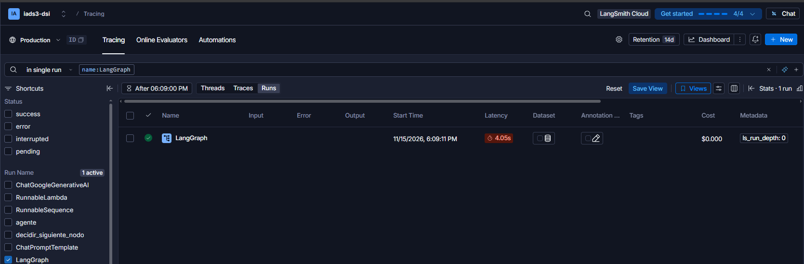
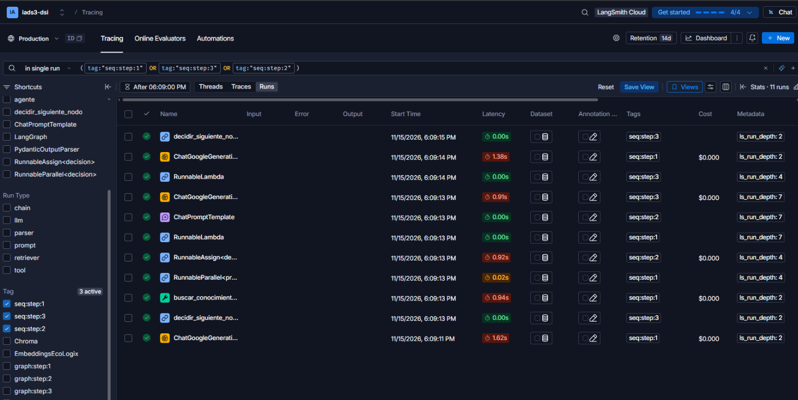
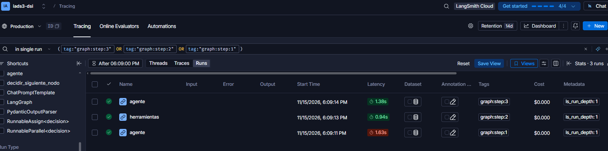
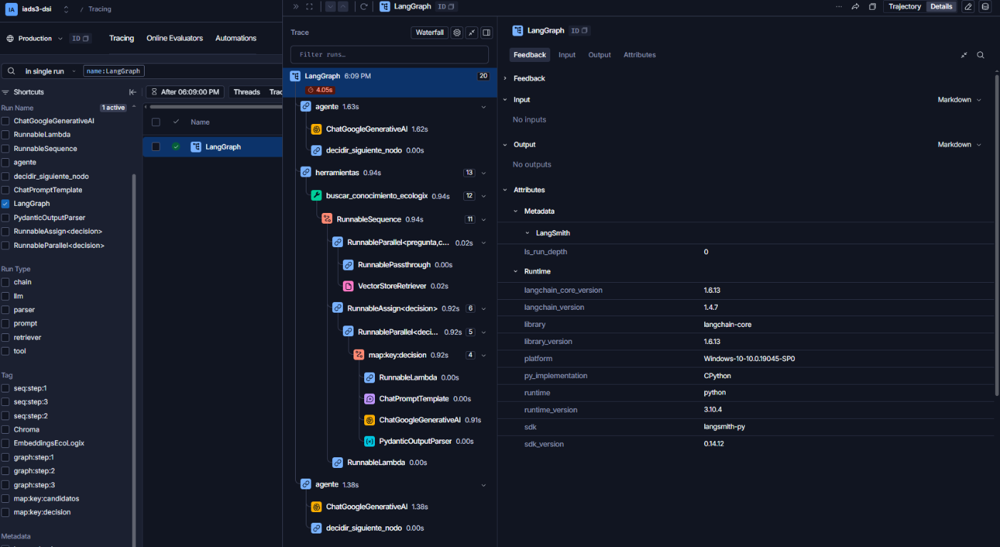
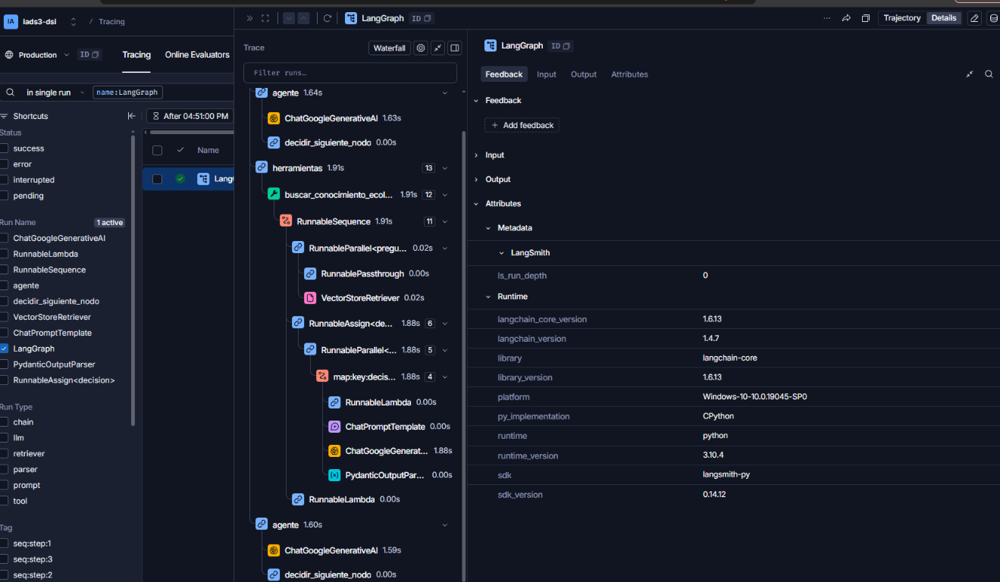

# TP Final Integrador — Agente Inteligente en Producción

## C. Observabilidad

### C.1 — Diseño

La API EcoLogix incorpora una capa de observabilidad compuesta por:

- logs operativos y de seguridad en formato JSON;
- métricas thread-safe acumuladas en memoria;
- endpoint `GET /metricas`;
- alerta de latencia basada en p95;
- tracing opcional mediante LangSmith con controles de privacidad.

La instrumentación se implementó en `observabilidad.py` y se integró en
`POST /consultar` sin modificar el contrato público de las respuestas.

### C.2 — Métricas implementadas

| Métrica | Criterio |
|---|---|
| Consultas totales | Solicitudes con formato válido que ingresan al manejador de `/consultar`. |
| Exitosas | El agente finaliza y devuelve una respuesta procesada sin errores de herramientas. |
| Fallidas | Ocurre un error técnico o el flujo no puede completarse correctamente. |
| Bloqueadas | Un guardrail interrumpe la consulta antes del modelo y las herramientas. |
| Latencia promedio | Promedio acumulado del tiempo total de procesamiento en milisegundos. |
| Latencia p95 | Percentil 95 calculado mediante rango más próximo desde las 20 muestras. |
| Herramientas | Invocaciones efectivamente ejecutadas, agrupadas por nombre. |
| Errores de herramientas | Resultados técnicos fallidos producidos durante las invocaciones. |

Las solicitudes bloqueadas cuentan como consultas y bloqueos, pero no como
errores técnicos. Las solicitudes rechazadas por FastAPI antes de ingresar al
manejador no forman parte de estos contadores.

Las métricas se acumulan desde el inicio del proceso y se reinician al reiniciar
la API. La primera versión utiliza memoria local y está diseñada para un único
proceso; no consolida resultados entre múltiples workers o instancias.

### C.3 — Latencia y alerta

El promedio se informa desde la primera muestra. Para evitar presentar un
percentil poco representativo, se definió una muestra mínima de 20 consultas
antes de publicar el p95. Hasta alcanzar ese valor, el endpoint devuelve
`p95: null` y no evalúa la alerta.

El umbral inicial es de 5000 ms. Cuando el p95 pasa de un estado normal a uno
superior al umbral, se activa `alerta_latencia` y se genera un único evento
`WARNING`. No se repite la advertencia en cada lectura de `/metricas`.

Esta decisión debe revisarse con tráfico representativo, ya que 20 solicitudes
constituyen una muestra inicial y no una calibración definitiva de producción.

### C.4 — Logs estructurados y privacidad

Los logs propios de EcoLogix se serializan como objetos JSON. Contienen
timestamp, nivel, logger, categoría, resultado e identificador aleatorio de
correlación.

No se registran:

- textos completos de consultas o respuestas;
- credenciales;
- identificadores de clientes;
- `thread_id` públicos o internos;
- mensajes completos de excepciones;
- datos personales.

Los errores se registran mediante categorías y eventos neutrales, sin incluir
el contenido recibido ni detalles que puedan exponer información interna.

### C.5 — Endpoint `GET /metricas`

El endpoint devuelve una fotografía consistente de los contadores, latencias,
herramientas y estado de alerta. No expone mensajes, conversaciones,
credenciales ni identificadores de clientes.

La respuesta incluye:

- momento de inicio de la ventana;
- consultas totales, exitosas, fallidas y bloqueadas;
- promedio, p95, cantidad de muestras y muestra mínima;
- invocaciones por herramienta y errores;
- estado y umbral de la alerta de latencia.

### C.6 — Trazabilidad con LangSmith

El tracing está desactivado por defecto. Para habilitarlo en las ejecuciones
que se quieran observar, configurar las siguientes variables de entorno. La
aplicación rechaza iniciar el tracing si alguno de los tres controles de
privacidad no está activo:

```dotenv
LANGSMITH_TRACING=true
LANGSMITH_HIDE_INPUTS=true
LANGSMITH_HIDE_OUTPUTS=true
LANGSMITH_HIDE_METADATA=true
```

El 15 de noviembre de 2026 se hicieron pruebas para verificar la privacidad
del tracing y el flujo real con el índice RAG persistido. Este cuadro resume
los grupos antes de detallar sus resultados:

| Prueba | Sección | Ejecución | Objetivo | Resultado principal |
|---|---|---|---|---|
| **Privacidad del tracing con canario** | **C.6.1** | 18:09 | Comprobar que inputs y outputs queden ocultos en una llamada identificable por marcador | HTTP 200; traza localizada por ID raíz; inputs/outputs vacíos en el dashboard |
| **Integración E2E y medición con RAG persistido** | **C.6.2** | 16:49 y 16:51 | Comprobar el flujo con Chroma, embeddings, reranking y herramienta RAG; obtener tokens y revisar jerarquía | Dos respuestas HTTP 200; la traza queda documentada en C.6.2 y los costos en C.7 |

Los distintos sets de pruebas se ejecutaron con un objetivo específico,
aunque la prueba de privacidad también recorrió el índice RAG.

#### C.6.1 — Privacidad del tracing: consulta con canario (18:09)

Para verificar la privacidad de la traza, se envió el siguiente mensaje a
`POST /consultar`:

```text
Que zonas cubre EcoLogix para las entregas? Para esta prueba de privacidad, codigo de control: ECOLG-PRIV-20261115-1809-M3P8. No repitas el codigo en la respuesta.
```

El marcador buscable es `ECOLG-PRIV-20261115-1809-M3P8`. La solicitud se
ejecutó el 15 de noviembre de 2026 entre las **18:09:11 y las 18:09:15
(UTC−3)**. La llamada respondió HTTP 200, invocó una vez la herramienta RAG y
`GET /metricas` registró una consulta exitosa. Se habilitó `LANGSMITH_TRACING`
y los tres controles `LANGSMITH_HIDE_INPUTS`, `LANGSMITH_HIDE_OUTPUTS` y
`LANGSMITH_HIDE_METADATA`.

El ID raíz capturado localmente es
`01a1e10a-ea90-70d6-86c9-2756ab83816c`. En el dashboard de observabilidad de
LangSmith, ese ID lleva a un único run raíz `LangGraph` iniciado a las 18:09,
con los runs descendientes de la llamada. En el detalle del run raíz, `Input`
y `Output` aparecen como `No inputs` y `No outputs`; en los listados de runs
las columnas de entrada y salida también aparecen vacías. La traza conserva
metadatos técnicos como `ls_run_depth` y tags de pasos, pero no se observan
valores de usuario.

Esta inspección confirma que el dashboard recibió la traza y que sus campos de
entrada/salida no muestran el mensaje ni el marcador. No se buscó el canario
dentro del payload recuperado: los controles de privacidad lo mantienen
oculto. El propósito del canario es identificar el contenido que se quería
proteger y dejar localizable la ejecución por ID y horario.

**Figura C.6.1 — Run raíz de privacidad.** Un solo run `LangGraph` aparece en
el horario de la prueba.



**Figura C.6.2 — Runs descendientes de la herramienta RAG.** Se muestran runs
anidados de la consulta, con inputs y outputs vacíos en el listado.



**Figura C.6.3 — Runs de los nodos del grafo.** Los pasos `agente` y
`herramientas` aparecen asociados a la ejecución.



**Figura C.6.4 — Árbol de trazabilidad y detalle del run raíz.** Se ve la
jerarquía y los campos `Input`/`Output` vacíos.



#### C.6.2 — Integración E2E y trazabilidad con RAG persistido (16:49 y 16:51)

Las dos ejecuciones enviaron una consulta de prueba por `POST /consultar` a la
aplicación real, con tracing habilitado para LangSmith, y usaron la
colección Chroma persistida `ecologix_chunks_500_100`, los embeddings locales y
el reranking del modelo configurado. La base de negocio y la memoria
conversacional fueron archivos SQLite temporales; no se usaron datos de
clientes ni se escribieron las bases persistentes. La ejecución de las 16:49
confirmó HTTP 200 y el uso de la herramienta RAG. Se repitió a las 16:51 para
medir tokens de forma fiable e inspeccionar la traza completa.

En la ejecución de las 16:51, `GET /metricas` informó una consulta exitosa y una
invocación de `buscar_conocimiento_ecologix`. La solicitud consumió 3656 tokens
de entrada y 146 de salida, agregados mediante callback. El dashboard de
observabilidad de LangSmith mostró un run raíz `LangGraph`, ID
`01a1e0c3-69c2-75b3-9125-dbe115b3129b`, iniciado a las 4:51:05 p. m. (UTC−3).
El indicador `20` junto al run raíz corresponde a sus descendientes: los 21
runs visibles son pasos anidados de una sola traza, no 21 consultas. El árbol
incluye los nodos `agente`, `decidir_siguiente_nodo` y `herramientas`, además
de spans internos del RAG para recuperación, prompts, reranking y parseo. En
el detalle del run raíz, `Input` y `Output` aparecen como `No inputs` y
`No outputs`.

**Figura C.6.5 — Run raíz de la prueba E2E con RAG de las 16:51.** El dashboard
identifica el run `LangGraph`, con hora y duración.


**Figura C.6.6 — Jerarquía y privacidad de la traza RAG de las 16:51.** Un run
raíz con 20 descendientes; su detalle no muestra inputs ni outputs.


**Figura C.6.7 — Spans internos del RAG de las 16:51.** La expansión muestra
pasos anidados de recuperación, reranking y generación, no ejecuciones
independientes.



### C.7 — Medición E2E y análisis de costos

#### Medición principal: E2E con índice RAG persistido

La medición principal corresponde a la ejecución del 15 de noviembre de 2026
a las 16:51 (UTC−3), detallada en C.6.2. Se envió una consulta de prueba por
`POST /consultar` y se recorrió la aplicación real con el modelo configurado,
`gemini-3.5-flash-lite`, la colección Chroma persistida
`ecologix_chunks_500_100`, los embeddings
locales, el reranking y la herramienta RAG. Para aislar los efectos operativos,
la base de negocio y la memoria se crearon en SQLite temporal; no se utilizaron
datos de clientes ni se modificaron las bases persistentes.

La solicitud respondió HTTP 200, invocó una vez `buscar_conocimiento_ecologix`
y registró una consulta exitosa en `GET /metricas`. El callback de uso del
modelo reportó **3656 tokens de entrada y 146 de salida** para las generaciones
de esa solicitud. Esta ejecución fue una observación del flujo integrado; no
es una estimación de tráfico promedio ni de producción.

La nueva prueba de privacidad de las 18:09, también con el índice RAG
persistido, registró **3712 tokens de entrada y 116 de salida**. Se informan
ambas ejecuciones para transparentar la variación entre consultas; la
ejecución de las 16:49 se excluye porque no se obtuvo un conteo fiable de
tokens.

| Ejecución | Tokens de entrada | Tokens de salida | Equivalente a tarifa paga |
|---|---:|---:|---:|
| 16:51, E2E RAG | 3656 | 146 | USD 0.0014618 |
| 18:09, E2E RAG con canario | 3712 | 116 | USD 0.0014036 |
| **Total (2 solicitudes)** | **7368** | **262** | **USD 0.0028654** |

El equivalente medio de esta muestra es USD 0.0014327 por solicitud. Son dos
observaciones de prueba, no una proyección representativa de producción.

#### Estimación económica

Como la cuenta utilizada está en el nivel gratuito, el cargo esperado por estas
pruebas es **USD 0**, sujeto a los límites y condiciones del plan. El dashboard
de observabilidad de LangSmith también muestra `$0.000`; este valor está
redondeado y no se toma como costo facturado. Para comparar con tarifa paga,
se calculó el equivalente usando USD 0.30 por millón de tokens de entrada y USD
2.50 por millón de tokens de salida:

```text
(3656 × 0.30 + 146 × 2.50) / 1 000 000 = USD 0.0014618
(3712 × 0.30 + 116 × 2.50) / 1 000 000 = USD 0.0014036
```

Los equivalentes calculados describen únicamente el consumo de modelo observado
en estas solicitudes. No incluyen otros servicios potencialmente facturables,
impuestos, descuentos ni diferencias de precio por nivel de cuenta. La
facturación efectiva depende de las condiciones vigentes del proveedor.

#### Alcance y fuente tarifaria

La medición representa una consulta E2E con el índice RAG del proyecto y
almacenamiento temporal para las operaciones de negocio. Es una muestra de dos
solicitudes, no una estimación del costo promedio de producción.

La fuente tarifaria consultada fue la
[página oficial de precios de Gemini API](https://ai.google.dev/gemini-api/docs/pricing#gemini-3.5-flash-lite)
(15 de noviembre de 2026). Los valores pueden cambiar y deben verificarse
nuevamente al actualizar el modelo o repetir el análisis. En el nivel gratuito,
Google indica que el contenido puede usarse para mejorar sus productos.